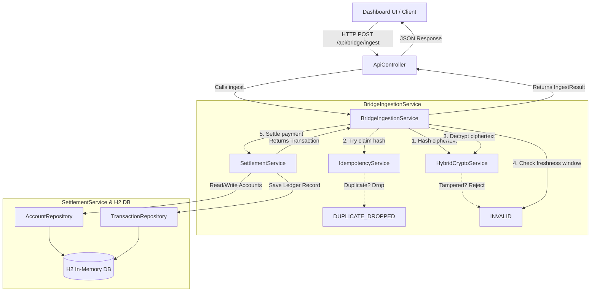

# 04 — Architecture & Component Relationships

This document describes the architecture of the UPI Offline Mesh backend and the relationships between its key components, backed by verified source code.

---

## Architectural Layering

The application follows a traditional **layered architecture** pattern (Controller → Service → Repository → Database), augmented with cryptography and simulation layers:

1. **Presentation / HTTP Layer (`com.demo.upimesh.controller`)**:
   - `DashboardController`: Serves the HTML UI.
   - `ApiController`: Handles REST requests (`/api/*`), parses JSON request bodies, and calls underlying services.

2. **Business Logic & Ingestion Layer (`com.demo.upimesh.service`)**:
   - `BridgeIngestionService`: Orchestrates the inbound pipeline (hash, claim, decrypt, freshness, settle).
   - `SettlementService`: Manages ACID transactional balance updates and ledger persistence.
   - `IdempotencyService`: Provides thread-safe deduplication.
   - `MeshSimulatorService` & `VirtualDevice`: Simulates mesh nodes and gossip forwarding.
   - `DemoService`: Seeds accounts and creates test packets.

3. **Cryptography Layer (`com.demo.upimesh.crypto`)**:
   - `ServerKeyHolder`: Manages RSA key generation.
   - `HybridCryptoService`: Handles hybrid encryption, authenticated decryption, and SHA-256 hashing.

4. **Persistence Layer (`com.demo.upimesh.model`)**:
   - `AccountRepository` & `TransactionRepository`: Spring Data JPA interfaces communicating with the H2 database.

---

## Mermaid Architecture & Data Flow Diagram

---

## Component Relationships

- **`ApiController` depends on `BridgeIngestionService`, `MeshSimulatorService`, `DemoService`, `ServerKeyHolder`, `AccountRepository`, `TransactionRepository`, and `IdempotencyService`**. It exposes endpoints for both the simulator UI and external bridge nodes.
- **`BridgeIngestionService` depends on `HybridCryptoService`, `IdempotencyService`, and `SettlementService`**. It acts as the gatekeeper for all inbound payment packets.
- **`SettlementService` depends on `AccountRepository` and `TransactionRepository`**. It encapsulates business logic inside `@Transactional` boundaries to ensure atomicity.
- **`HybridCryptoService` depends on `ServerKeyHolder`** to retrieve the private RSA key required for decryption.
- **`MeshSimulatorService` manages a collection of `VirtualDevice` objects**, facilitating in-memory gossip and packet collection.
